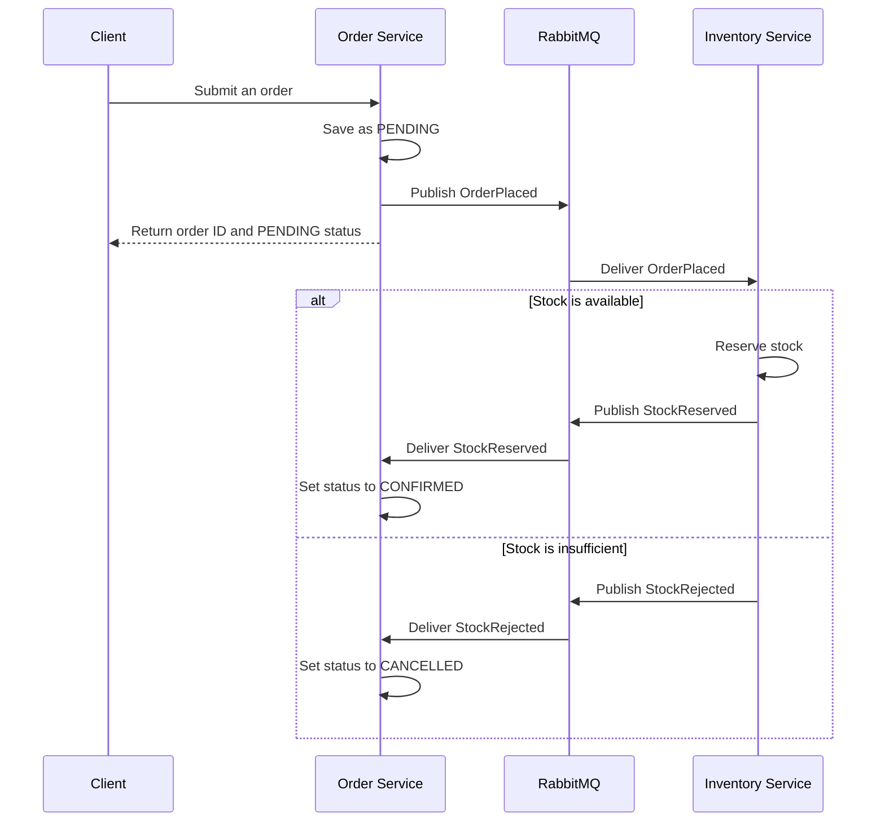

# Maltashop-Ecom

A small e-commerce backend demonstrating how two independent services can process an order without sharing a database or making synchronous calls to one another. RabbitMQ carries the events between the Order Service and Inventory Service, and a choreography-based saga completes or cancels each order.

## Project overview

| Service | Role | Data store |
|---|---|---|
| Order Service | Accepts orders, records their status, and handles inventory results | PostgreSQL (`orders`) |
| Inventory Service | Checks and reserves stock, then reports the result | PostgreSQL (`inventory`) |
| RabbitMQ | Delivers events between services | — |

Each service owns its database. The Order Service publishes `OrderPlaced`; the Inventory Service responds with either `StockReserved` or `StockRejected`. A successful order becomes `CONFIRMED`; an order that cannot be fulfilled becomes `CANCELLED`.

## How an order is processed



## Requirements

- Docker Desktop with Docker Compose
- Git, to clone the repository
- Node.js 20 or later, only if running the services or tests directly on your machine

## Start the application

Clone the repository and start the services:

```bash
git clone https://github.com/cpnnabin/Maltashop-Ecom.git
cd Maltashop-Ecom
docker compose up --build
```

Docker Compose starts RabbitMQ, a separate PostgreSQL database for each service, and both application services.

| Address | Purpose |
|---|---|
| `http://localhost:3000/health` | Order Service liveness |
| `http://localhost:3000/ready` | Order Service database and broker readiness |
| `http://localhost:3001/health` | Inventory Service liveness |
| `http://localhost:3001/ready` | Inventory Service database and broker readiness |
| `http://localhost:3001/stock/SKU-100` | View available stock for a product |
| `http://localhost:15672` | RabbitMQ management console |

The default RabbitMQ console login is `guest` / `guest`. These defaults are intended for local development; change them before using the application in a shared environment.

## Place a test order

The sample data includes 50 units of `SKU-100` and 5 units of `SKU-200`. This order requests two units of `SKU-100`:

```bash
curl -X POST http://localhost:3000/orders \
  -H "Content-Type: application/json" \
  -H "X-Correlation-ID: demo-order-001" \
  -d '{"customerId":"customer-001","productId":"SKU-100","quantity":2}'
```

The response includes an order ID and an initial `PENDING` status. Check the order a moment later using the returned ID:

```bash
curl http://localhost:3000/orders/<order-id>
```

With sufficient stock, its status changes to `CONFIRMED`. To demonstrate the rejection path, request more than the five available units of `SKU-200`; the order will become `CANCELLED`.

Follow the correlation ID through both services' logs:

```bash
docker compose logs order-service inventory-service
```

## HTTP API

| Method | Endpoint | Service | Result |
|---|---|---|---|
| `POST` | `/orders` | Order | Creates an order and returns `202` with its ID and `PENDING` status |
| `GET` | `/orders/{id}` | Order | Returns an order by UUID; responds with `400` for an invalid ID or `404` if it does not exist |
| `GET` | `/health` | Both | Reports whether the service process is running |
| `GET` | `/ready` | Both | Checks whether the service can reach its database and RabbitMQ |
| `GET` | `/stock/{productId}` | Inventory | Returns the available stock for a product |

An order request contains `customerId`, `productId`, and `quantity`. Customer IDs must be 1–100 characters, product IDs 3–40 characters, and quantities whole numbers from 1 to 100. Invalid input returns `400` with validation details.

`X-Correlation-ID` is optional when creating an order. A valid supplied ID is returned in the response and included in service logs and event messages; otherwise, the Order Service generates one.

## Events and message delivery

Services exchange versioned JSON event envelopes through the RabbitMQ `orders` topic exchange:

| Event | Routing key | Direction |
|---|---|---|
| `OrderPlaced` | `order.placed` | Order Service → Inventory Service |
| `StockReserved` | `stock.reserved` | Inventory Service → Order Service |
| `StockRejected` | `stock.rejected` | Inventory Service → Order Service |

The event schemas are in [`contracts/`](contracts). Contract tests check that event payloads follow those schemas.

Queues and messages are durable, and publishers use broker confirmations. Messages are acknowledged after handling. Invalid messages are dead-lettered; temporary failures are retried up to the configured attempt limit before being dead-lettered. Inventory records one reservation decision per order, preventing duplicate deliveries from reserving the same stock more than once.

## Configuration

Docker Compose works with its local defaults. To override them, copy [`.env.example`](.env.example) to `.env` in the repository root and edit the values:

| Variable | Default | Purpose |
|---|---|---|
| `RABBITMQ_USER` | `guest` | RabbitMQ username |
| `RABBITMQ_PASSWORD` | `guest` | RabbitMQ password |
| `ORDER_DB_PASSWORD` | `order` | Order database password |
| `INVENTORY_DB_PASSWORD` | `inventory` | Inventory database password |
| `LOG_LEVEL` | `info` | Structured log verbosity |

The services also support `PORT`, `DATABASE_URL`, and `RABBITMQ_URL`. Message retry settings can be configured with `MAX_DELIVERY_ATTEMPTS` and `RETRY_DELAY_MS`. Service-specific environment examples are in [`order-service/.env.example`](order-service/.env.example) and [`inventory-service/.env.example`](inventory-service/.env.example). Keep real credentials out of version control.

## Run the tests

Install dependencies and run each service's unit tests, followed by the contract and cross-service flow tests:

```bash
cd order-service
npm ci
npm test

cd ../inventory-service
npm ci
npm test

cd ../tests
npm ci
npm test
```

Database integration tests require PostgreSQL and a `TEST_DATABASE_URL` connection string. Run them from each service directory with:

```bash
npm run test:db
```

The end-to-end smoke test expects the Docker Compose stack to be running:

```bash
docker compose up -d --build --wait
node scripts/smoke-test.js
```

Continuous integration runs the unit, contract, database, Docker build, and smoke tests on pushes and pull requests.

## Repository structure

```text
order-service/       Order API, saga handling, and service tests
inventory-service/   Inventory API, stock reservations, and service tests
contracts/           JSON Schemas for messages exchanged by the services
tests/               Contract and cross-service flow tests
scripts/             End-to-end smoke test
docs/screenshots/    Project screenshots
docker-compose.yml   Local application and infrastructure configuration
```

## Current scope

This repository is a learning and demonstration project, not a production-ready commerce platform. It does not include authentication, payments, an API gateway, distributed tracing, or a transactional outbox. The HTTP API accepts one product per order. Dead-lettered messages require manual inspection and replay.

## Stop the services

Stop the containers and keep their database volumes:

```bash
docker compose down
```

To also delete the local database data, run:

```bash
docker compose down -v
```

Deleting the volumes removes the local order and inventory data.
